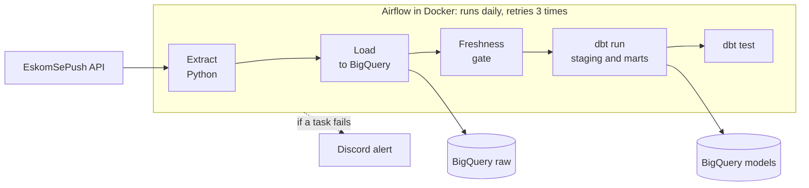

# sa-power-pipeline


A data pipeline that collects South African load shedding data every day, stores it in the cloud, and turns it into clean, tested tables that a dashboard or app can use. It runs on a schedule with no manual steps, and it messages me on Discord when something breaks.

## What it does

1. **Collects** load shedding status, area details and outage schedules from the EskomSePush API.
2. **Stores** every raw response in Google BigQuery, exactly as received, so history is never lost.
3. **Checks** that the data is fresh, and stops if the API has gone quiet.
4. **Transforms** the data with dbt into tables that answer plain questions: what stage is load shedding at right now, and how has it changed over time?
5. **Tests** the results automatically, and sends a Discord alert if any step fails.



A poster version of this diagram is in [`docs/architecture.png`](docs/architecture.png).

## What this project shows

| Skill | Where to look |
| --- | --- |
| Pipeline orchestration | An Airflow DAG with five tasks, a daily schedule, 3 retries per task and failure alerts: [`dags/sa_power_pipeline_dag.py`](dags/sa_power_pipeline_dag.py) |
| ELT with dbt | Staging and mart models, plus an incremental history table: [`sa_power_dbt/`](sa_power_dbt/) |
| Cloud data warehouse | BigQuery with separate datasets for raw data, development and CI |
| Data quality | A freshness gate (warns at 12 hours, fails at 36), tests on keys, allowed values and completeness, and loads that never repeat a file |
| Containers | A custom Airflow image with dbt in its own isolated environment, run with Docker Compose: [`docker/`](docker/) |
| CI/CD and security | GitHub Actions runs lint, tests, a dbt parse, a Docker build and a real dbt build in BigQuery, logging in with Workload Identity Federation so no credentials are stored: [`.github/workflows/ci.yml`](.github/workflows/ci.yml) |
| Honest engineering | Built in small steps, with every bug and fix written down: [`docs/BUILD_LOG.md`](docs/BUILD_LOG.md) |

## Why load shedding

Load shedding is part of daily life in South Africa, and the data behind it is awkward in useful ways: nested API responses, a free tier of 50 requests a day, and schedules that change. Building against real constraints like these is the point of the project.

## How the data is organised

| Layer | Dataset | What is in it |
| --- | --- | --- |
| Raw | `raw` | Status, area and schedule responses as the API sent them, one row per pull. Rows are only ever added. |
| Staging | `dbt_dev` | `stg_status`: one row per region per pull, unpacked from the nested response. |
| Marts | `dbt_dev` | `mart_current_status`: the latest stage for each region. `fct_status_history`: the full history, built incrementally, one row per region per pull. |

## What one daily run does

| Task | What it does |
| --- | --- |
| `extract_from_eskomsepush` | Calls the status, area and schedule endpoints. Fails loudly if any call fails, so retries and alerts trigger. |
| `load_to_bigquery` | Appends the new raw files to BigQuery, then archives them so they are never loaded twice. |
| `dbt_source_freshness` | Stops the run if the newest raw data is too old, so stale data never reaches the marts. |
| `dbt_run` | Builds the staging and mart models. |
| `dbt_test` | Runs the dbt tests on the result. |

A run uses 3 of the 50 daily API requests.

## Decisions worth explaining

- **Raw data is append-only.** Uniqueness is enforced in dbt, not by deleting raw rows. When the history model's uniqueness test first failed, it exposed duplicate loads from earlier in the build, and the model now removes them.
- **Extraction fails loudly.** An API error used to be logged and ignored, which left the task green. It now raises, so retries, alerts and the freshness gate can do their jobs.
- **dbt has its own environment inside the Airflow image.** Their dependencies conflict, so keeping them apart is the clean fix.
- **CI uses Workload Identity Federation.** The CI service account can read `raw` and write only to a separate `dbt_ci` dataset, and the identity provider only accepts tokens from this repository.

## Run it yourself

You need Docker, an [EskomSePush](https://esp.info) API token, and a Google Cloud project with BigQuery datasets named `raw` and `dbt_dev`. The profiles use the `africa-south1` region, so change `location` in `docker/dbt_profiles/profiles.yml` if yours differs.

```bash
cp .env.example .env        # add your token, project ID, key file path and Discord webhook
docker compose build
docker compose up airflow-init
docker compose up -d
```

Open <http://localhost:8080> (local login `admin` / `admin`), un-pause `sa_power_pipeline` and trigger it.

For development without Docker:

```bash
python -m venv .venv && source .venv/bin/activate
pip install -r requirements.txt -r requirements-dev.txt
pip install -e .
ruff check . && pytest -v
```

## Repo layout

```
dags/                       Airflow DAG: extract, load, freshness, dbt run, dbt test
src/sa_power_pipeline/
    fetch_status.py         calls the EskomSePush API
    load_bigquery.py        loads raw files into BigQuery
    alerts.py               Discord failure alerts
    config.py               settings
    run_pipeline.py         runs extract and load outside Airflow
sa_power_dbt/               dbt project: sources, staging, marts, tests
tests/                      unit tests
docker/                     Airflow image and the dbt profile used in containers
.github/workflows/          CI
docs/                       architecture diagram and build log
```

## Limits and what comes next

- It tracks one area (Fourways, Johannesburg), set in `config.py`.
- Only the status data is modelled in dbt so far. Area and schedule responses are loaded into `raw` but not yet modelled.
- There is no dashboard yet. The mart tables are ready for one.
- It runs in Docker Compose on my machine, not on a cloud host.
- I considered Property24 as a second source and dropped it, because it has no public API and the only access is scraping. A documented source is a better fit for this project.

## Build log

This project was built in small steps, one commit at a time, starting from a rough script. [`docs/BUILD_LOG.md`](docs/BUILD_LOG.md) lists every step, what went wrong and what I learned.

## License

MIT. Built by Kabelo Maile.